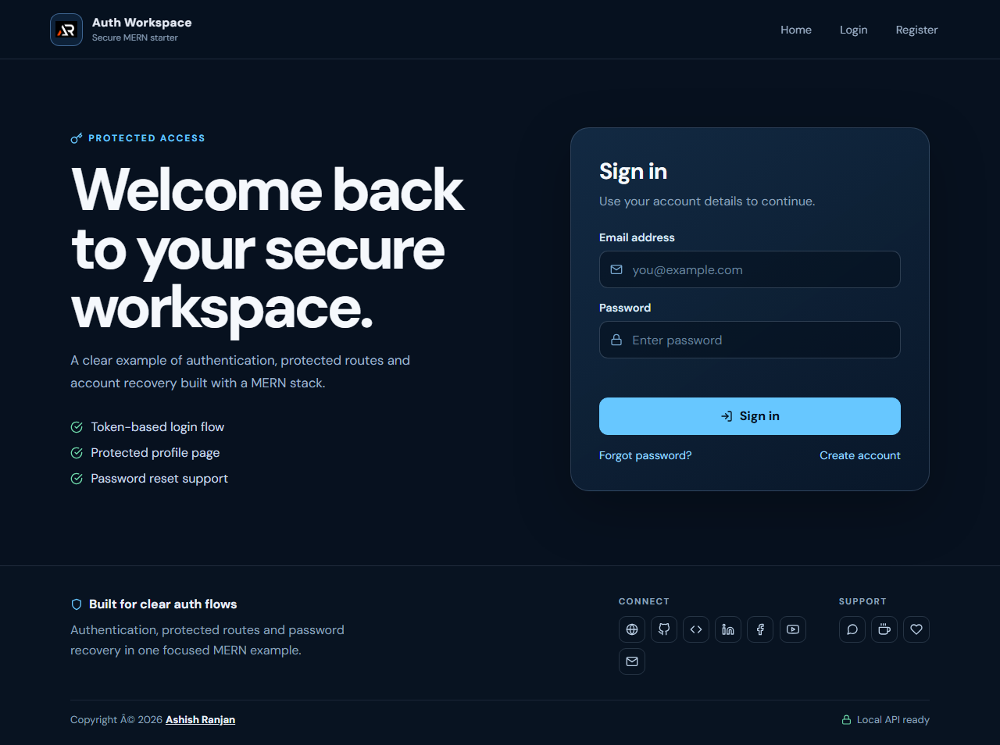

# MERN Stack Authorization Example

A full-stack authentication starter with a React client and an Express, MongoDB, and Mongoose API. It includes registration, sign-in, protected profile access, logout, and email-based password recovery.

## Features

- JWT sessions stored in HttpOnly cookies rather than browser storage.
- Protected React routes backed by server-side session verification.
- Password hashing with bcrypt and password reset tokens that expire after 15 minutes.
- Password reset responses that do not disclose whether an email address has an account.
- Origin checks on write requests, credentialed CORS, input validation, and safe API errors.
- GitHub Pages compatible client routing with HashRouter.

## Stack

React 18, React Router 6, Axios, Sass, Node.js, Express, MongoDB, Mongoose, JWT, bcryptjs, and Nodemailer.

## Run locally

Requirements: Node.js 22 or later and a MongoDB instance.

1. Configure the API:

    cd server
    Copy-Item .env.example .env
    npm install
    npm start

2. In another terminal, configure and start the client:

    cd client
    Copy-Item .env.example .env
    npm install
    npm start

The client runs at http://localhost:3000 and the API at http://localhost:1198. Set the API URL in client/.env if the API uses a different address.

## Configuration

The API reads environment variables from server/.env. Set MONGODB_URI and replace JWT_SECRET with a randomly generated value of at least 32 bytes. Password recovery also needs a Gmail OAuth client and refresh token; fill in the OAuth fields in server/.env. Without email credentials, registration and sign-in work, but reset email delivery is unavailable.

For a deployed client, set these API values:

- NODE_ENV=production
- CLIENT_ORIGIN to the exact browser origin, without a path (for this GitHub Pages client: https://a2rp.github.io)
- CLIENT_URL to the full client base URL, including the repository path (https://a2rp.github.io/mern-stack-authorization-example)
- COOKIE_SAME_SITE=none
- REACT_APP_API_URL in the client build environment to the deployed API base URL

Serve the API over HTTPS in production. Use a strong, unique JWT_SECRET and keep all server credentials private. The GitHub Pages client and a separately hosted API are cross-site; browsers that block third-party cookies can prevent sign-in from persisting. Hosting the client and API on the same site, or placing the API behind a same-origin proxy, provides the most reliable cookie behavior. CORS and the write-request origin check must include the actual client origin.

## API routes

- POST /api/auth/register
- POST /api/auth/login
- POST /api/auth/logout
- POST /api/auth/forgotpassword
- PUT /api/auth/resetpassword/:resetToken
- GET /api/private

JSON write requests must come from an origin listed in CLIENT_ORIGIN. Protected requests use the HttpOnly session cookie.

## Deploy the client

The client package includes a GitHub Pages deploy script. Set REACT_APP_API_URL in the build environment before deployment. Password reset links use hash routing so they load correctly from the project page.

## Screenshot

## Links

- Portfolio: https://www.ashishranjan.net/
- GitHub: https://github.com/a2rp
- CodePen: https://codepen.io/ash1198
- LinkedIn: https://www.linkedin.com/in/aashishranjan
- Facebook: https://www.facebook.com/theash.ashish/
- YouTube: https://www.youtube.com/@ashishranjan-ashz?sub_confirmation=1
- Email: ash.ranjan09@gmail.com
